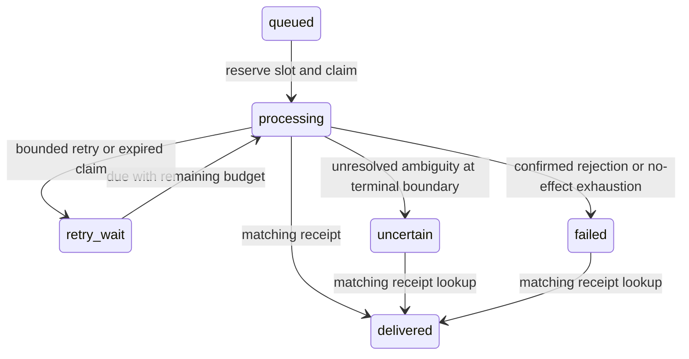

# Local correctness demonstration

Measured 1 November 2026, Brisbane. This is one bounded synthetic portfolio sample,
not a throughput benchmark, production SLA or evidence of commercial Go tenure.

## Source and method

Final corrected executable: `a4c413608dc4680305020a7e94beeb3de0b5d96d`.
Private corrected-source run: `20261031T225855490Z`, fresh database
`p27_run_0be8492b3f2b`. It passed A1-A8 with the unchanged frozen expectations.

Original executable: `5ab629f2f939e501e3f31bd355ef4c1992f922ab`, private run
`20261031T224036695Z`, database `p27_run_67f0aa2c5329`. It passed on its first
canonical attempt. The additional run validates review corrections to shared HTTP
and cleanup code; it does not replace the original or tune the sample.
All twelve event IDs, values, fault settings and expected counts were frozen in
the committed fixture/design/plan before execution. Source-file hashes were
checked before and after the run. The retained bundle contains a source archive,
worker binary, fixture/config hashes, SQL snapshots, process exits, command receipts
and actual HTTP/trace logs; 166 files are inventoried, plus the outer result JSON.
Raw evidence and local database/cache volumes remain private and ignored.

Environment: existing Ubuntu WSL2 Docker 29.7.2, Compose 5.4.0, Linux amd64,
Go 1.27.3, PostgreSQL 18.6, pgx 5.11.0 and OpenTelemetry trace SDK 1.47.0.
Official Go/PostgreSQL images are pinned by immutable digest in compose.yaml.
No global runtime/security/PATH modification, provider inference, paid service,
application cloud deployment or public source publication was needed.

## Observed outcomes

Each run independently matched the following counts in its fresh database.

| Group | Event IDs | Worker reservations | Worker POSTs | Separate probes | Receiver effects |
|---|---:|---:|---:|---|---:|
| A1 normal/concurrency | 4 | 4 | 4 | None | 4 |
| A2 exact/conflicting identity | 1 | 1 | 1 | Two exact and one conflicting POST | 1 |
| A3 transient/rejection | 2 | 3 | 3 | None | 1 |
| A4 retry exhaustion | 1 | 3 | 3 | None | 0 |
| A5 graceful cancellation/late commit | 1 | 2 | 2 | None | 1 |
| A6 actual kill/restart | 1 | 2 | 1 | None | 1 |
| A7 committed effect/lost response | 1 | 2 | 2 | None | 1 |
| A8 terminal ambiguity/reconcile | 1 | 3 | 3 | One receipt GET | 1 |
| Total | 12 | 20 | 19 | Three POSTs and one GET | 10 |

Independent receiver HTTP observations matched 22 POSTs: nineteen worker sends
and three explicit identity probes. Queue reservations are counted separately:
A6 consumed a slot before the worker was killed, without making that send.
Final job states were ten delivered and two failed, with no remaining uncertain
job after the explicit A8 receipt reconciliation. There was no fourth worker slot
or fresh-ID resend. Receiver receipts and export effects matched atomically.

A1's controlled gate observed exactly two simultaneous deliveries, never more.
A5 observed context cancellation and worker exit before releasing the receiver's
precommit gate; the receiver then committed despite the disconnected client, and
restart recovered the same receipt. Cancellation did not roll back the effect.
A6 used an actual SIGKILL, observed exit-by-signal, preserved the committed claim
and waited for genuine ten-second lease expiry before recovery. A7 closed an
actual connection after receiver commit and replay returned the original receipt.
A8 dropped all three POST responses, retained uncertain state across a worker
restart with zero further sends, then resolved it through one read-only GET.

The HTTP status/drop/gate behaviors are deliberate fixture injections. The
worker signals, HTTP transport errors, PostgreSQL commits and process restarts
are real observations. They do not establish behavior for an arbitrary receiver.
Replay safety depends on this owned receiver's durable identity/atomicity contract.

| Measured duration | Original source | Corrected source |
|---|---:|---:|
| Runtime including application-process cleanup | 15.458 s | 15.735 s |
| Runtime including outer container cleanup | 24.166 s | 24.272 s |
| Preparation/build, separate | 6.018 s | 4.563 s |
| Maximum graceful worker shutdown, rounded up | 1.015 s | 1.018 s |

Both complete samples were below 300 seconds; all observed graceful worker stops
were below five seconds. Each duration describes one run on its named source.
The two runs are correctness observations, not a latency distribution or load study.

## Software checks and tracing

Before each canonical execution, the All profile passed formatting, module checksum
verification, vet, build, real PostgreSQL/HTTP checks and full Linux race detection.
The original source had **69 passing Go test events including subtests**. Corrected
source had **84 passing Go test events**, zero failing/skipped events, plus two
separate PowerShell preparation-cleanup cases. These are software checks, not
independent runtime scenarios.
The race environment was Linux amd64 with CGO enabled. Actual canonical recovery
was verified separately rather than substituted with mocked SQL or simulated kills.

Software checks cover strict event identity/JSON boundaries, stale ownership,
sticky ambiguity, database and total HTTP deadlines, transport wire counts,
shutdown/cancellation, read-only reconciliation, trace linking/failure and evidence
mutation rejection. The 500 ms connect deadline is configured; this sample does
not independently characterize Internet connection timeout behavior.

[Sanitized corrected-source trace](trace-example.json) retains the actual enqueue, durable
attempt and receiver span identities/times for one A1 event. W3C propagation links
the spans, and the stored enqueue parent survives restart. Goroutine counts and
task joins were observed; no universal goroutine-leak detector is claimed.
The [original trace](trace-example-original.json) is retained separately.

## Cleanup and remaining gates

Every owned application process was observed exited. Receiver-listener absence
was checked inside the runtime. Both p27-local containers were then stopped and
no owned running container remained. The database and two build/module cache
volumes were retained for evidence and review; other projects were untouched.
Compose's three-second stop timeout ended the idle tooling container with exit
137 and OOMKilled=false, after its application processes had already exited.
Read-only retained-evidence verification passed for both bundles, all 334 files
unchanged by hash and modification time. Separately removed one-shot tooling
containers performed these readbacks without starting the database.

One fresh independent review found two Important findings and a Minor overflow
case, regraded Important for its early-send effect. All three were reproduced
and fixed in one correction pass, with 84 passing Go test events, two preparation-
cleanup regressions and full race checks. See the [execution record](execution-record.md).
The corrected-source runtime verification also passed; no second independent review
was performed under the approved single-review workflow. No deferred minors remain.
Only the owner's local integration choice is pending. No distributed exactly-once delivery, multi-worker fencing/HA,
production authentication, external webhook safety or sustained-load claim follows.
